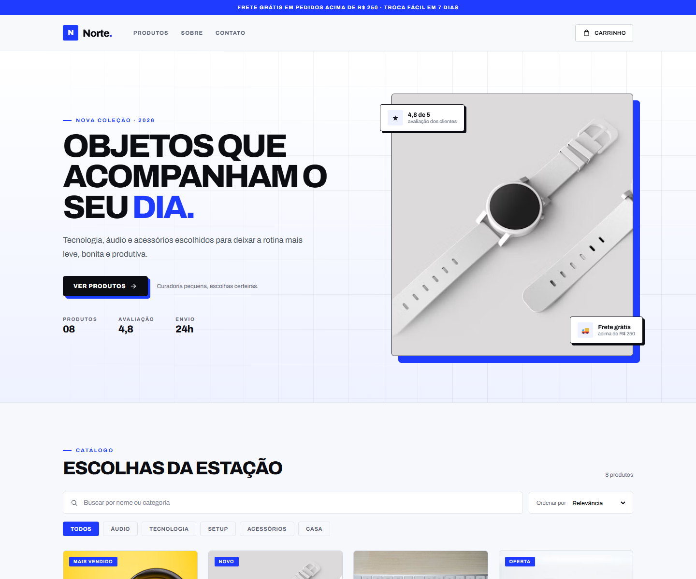

# Norte Store — Loja Virtual

Repositório: [github.com/LeonardoCarrilho/loja-virtual](https://github.com/LeonardoCarrilho/loja-virtual)
**Demo:** [leonardocarrilho.github.io/loja-virtual](https://leonardocarrilho.github.io/loja-virtual/)

Loja virtual responsiva feita com **React + Vite**, com catálogo, busca, filtros, carrinho persistente e checkout de demonstração.




## Design

Interface editorial em cobalto, preto e branco, com tipografia Archivo, título oversized, sombras duras e uma seção About escura. O objetivo é ter personalidade de marca, não cara de template.

- Layout responsivo com hero em duas colunas no desktop e empilhado no mobile;
- Carrinho lateral e checkout em modal;
- Estados de foco, contraste e textos alternativos revisados.

## Funcionalidades

- Catálogo com 8 produtos e imagens
- Busca por nome, descrição ou categoria
- Filtro por categoria, favoritos e faixa de preço
- Ordenação por relevância, menor/maior preço, nome A-Z e avaliação
- Contagem de resultados e botão para limpar todos os filtros
- Favoritos persistentes no `localStorage`, com contador no header e estado vazio
- Carrinho lateral com quantidade, remoção e subtotal
- Limite de quantidade conforme o estoque de cada produto
- Persistência do carrinho no `localStorage`
- Cálculo de frete grátis acima de R$ 250
- Carrinho acessível: fecha com `Esc`, foca ao abrir, devolve o foco ao fechar e anuncia mudanças com `aria-live`
- Checkout com validação de nome, e-mail e CEP
- Confirmação de pedido com código gerado
- Layout responsivo (desktop, tablet e celular)

> **Atenção:** este é um projeto de demonstração. Nenhum pagamento é processado e nenhum dado é enviado para um servidor.

## Como rodar

```bash
npm install
npm run dev
```

Para gerar a versão de produção:

```bash
npm run build
npm run preview
```

## Testes

Os testes usam **Vitest** com **jsdom** e cobrem o carrinho, os favoritos, os filtros/ordenação do catálogo e a formatação de preço.

```bash
npm test
```

## Estrutura

```
src/
├── components/
│   ├── Header.jsx
│   ├── ProductCard.jsx
│   ├── CartDrawer.jsx
│   └── CheckoutModal.jsx
├── data/
│   └── products.js       # catálogo
├── hooks/
│   ├── useCart.js        # carrinho + localStorage + estoque
│   └── useFavorites.js   # favoritos + localStorage
├── test/
│   └── renderHook.js     # helper para testar hooks
├── utils/
│   ├── catalog.js        # filtros e ordenação
│   └── format.js         # formatação de preço
├── App.jsx
├── main.jsx
└── styles.css
```

## Personalizando

- **Produtos:** edite `src/data/products.js` (nome, preço, categoria, imagem, descrição e estoque).
- **Frete grátis:** ajuste `FREE_SHIPPING_FROM` e `SHIPPING_PRICE` em `src/hooks/useCart.js`.
- **Cores e fontes:** edite as variáveis no topo de `src/styles.css`.
- **Imagens:** as URLs atuais são do Unsplash. Se uma imagem falhar, o card mostra automaticamente um fundo com emoji.

## Deploy

Publicado no **GitHub Pages**: [leonardocarrilho.github.io/loja-virtual](https://leonardocarrilho.github.io/loja-virtual/).

Projeto estático, pronto também para Vercel ou Netlify:

- **Build command:** `npm run build`
- **Output directory:** `dist`
- **Base do Vite:** `./`, para funcionar em subdiretórios

## Licença

MIT — use livremente para estudos e portfólio.

## Contribuição e segurança

Leia [AGENTS.md](AGENTS.md) antes de alterar o projeto. Toda tarefa exige issue e PR associado, com validação antes da publicação.

Configuração de produção, observabilidade e limites da hospedagem: [docs/SECURITY.md](docs/SECURITY.md).
